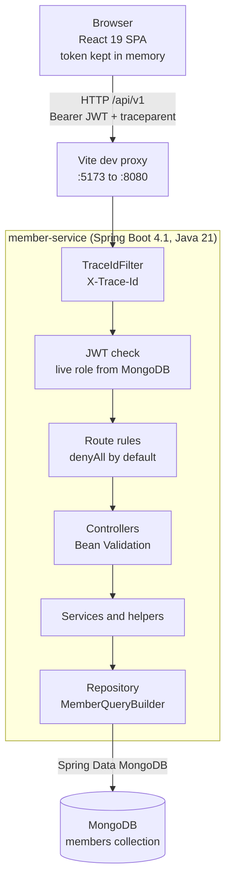
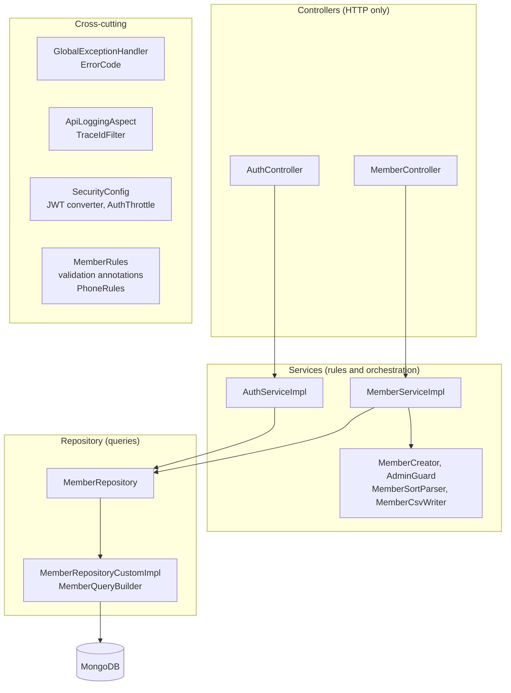
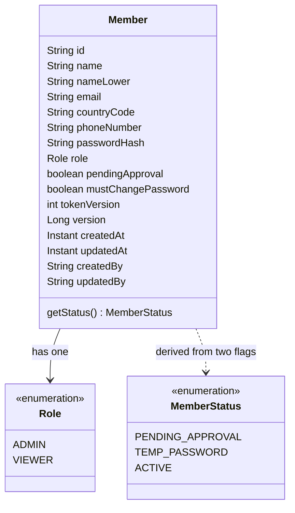
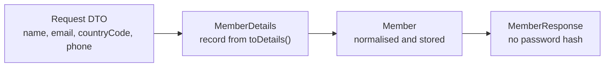
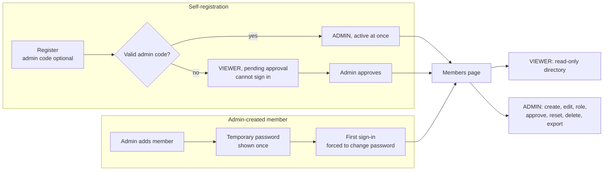
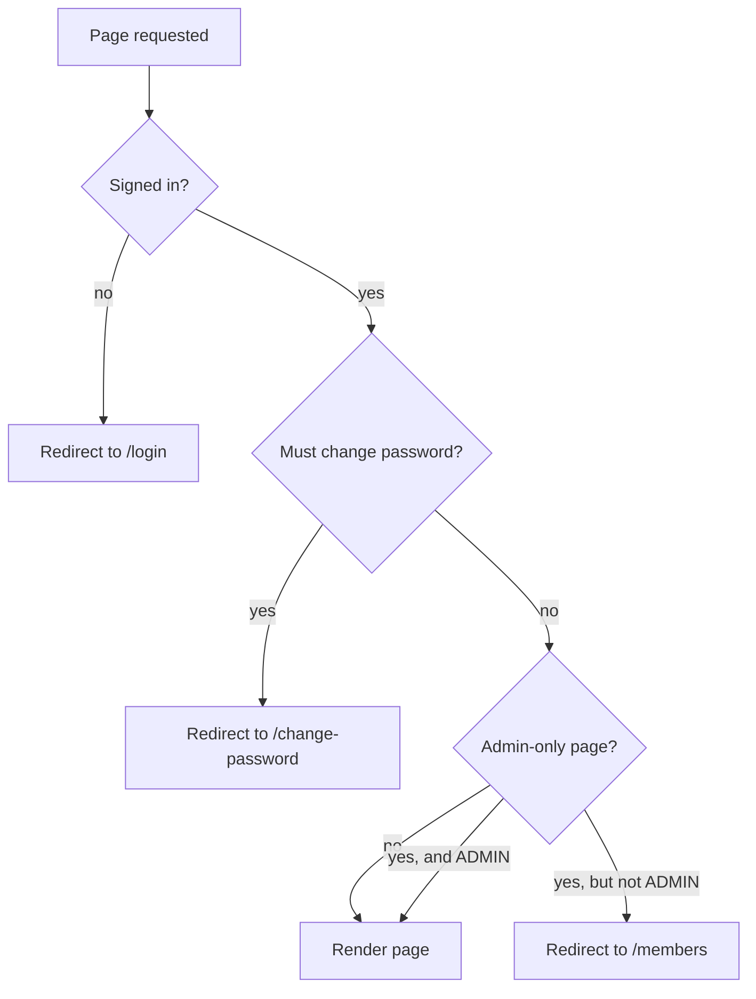
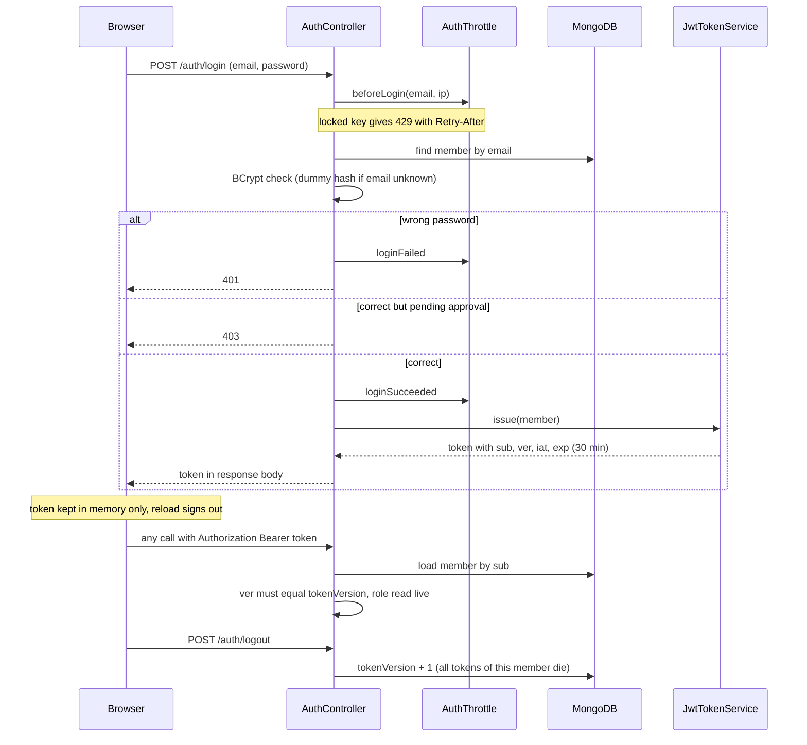
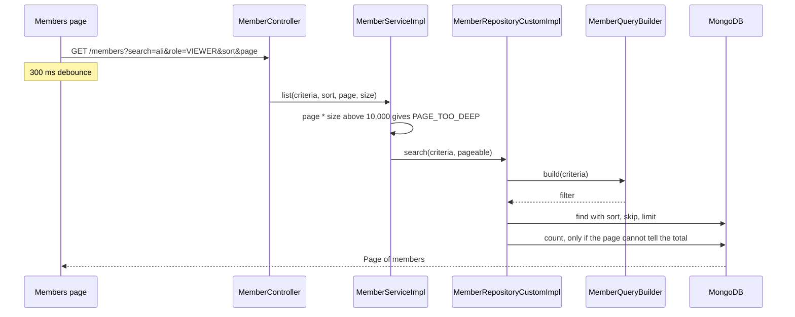
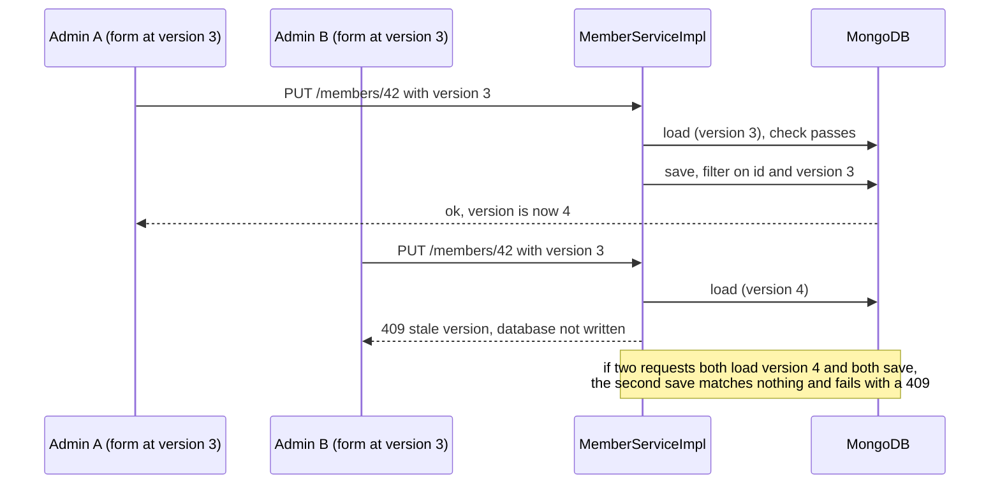
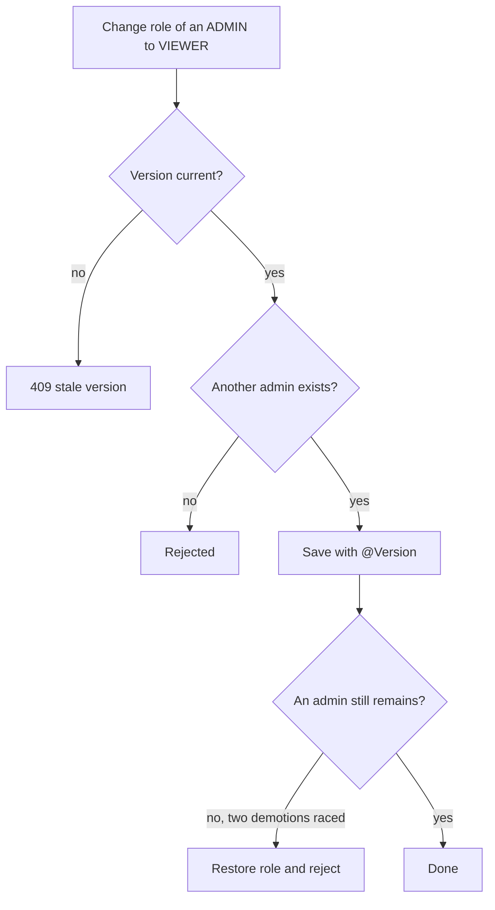

## Architecture and flows

All diagrams are [Mermaid](https://mermaid.js.org/), so they render on GitHub and in the IntelliJ / VS Code Markdown preview.

### 1. System architecture



Transport is plain HTTP locally; terminate TLS in front of the service in production (see Production notes).

### 2. Backend layers



### 3. Entities and role types



Notes:
- `Member` is the entity; the only roles are **ADMIN** and **VIEWER**.
- Status has no stored field. `pendingApproval` first, then `mustChangePassword`, decide it.
- `pendingApproval` is stored so that `false` means approved: documents saved before approval existed have no such field and read as approved.
- `version` (`@Version`) detects edit conflicts. `tokenVersion` revokes sessions. They are different counters.

How data changes shape on the way in and out:



### 4. UI flow



### 5. Page routing by role (React)



These guards only shape the experience. The server enforces access on every call, so a viewer who forces an admin request still gets 403.

### 6. Sign-in, token and session



The token carries no role. A demotion, deletion, sign-out, password change or admin reset takes effect on the next request.

### 7. Search flow



Example filter for `search=ali`, `role=VIEWER`:

```json
{ "$and": [
    { "$or": [ { "nameLower": { "$regex": "^ali" } },
               { "email":     { "$regex": "^ali" } } ] },
    { "role": "VIEWER" }
] }
```

The search term is lower-cased and regex-escaped, so it is always a literal prefix match.

### 8. Data integrity: edit conflicts and the last admin

Two admins edit the same member (optimistic locking, two layers):



Demoting an admin (best-effort protection for the last admin):



Related rules in `AdminGuard`: admins cannot be deleted, bulk delete never removes admins (the query itself excludes them), and an admin's password cannot be reset through the admin flow.
