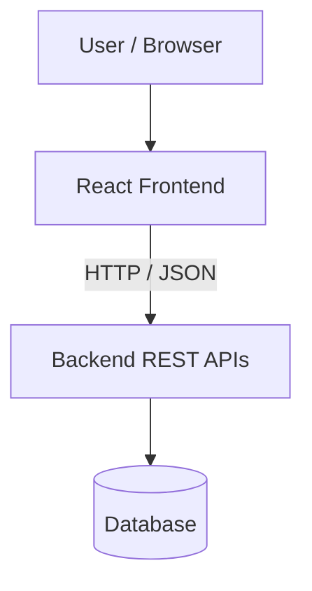

# kitchensink-modernized
Modernized version of JBoss Kitchensink using current Java, Spring Boot, React and MongoDB.
# Kitchensink Modernized

A modernization of the classic JBoss Kitchensink application, restructured into a modern frontend and backend architecture.

## Overview

Kitchensink Modernized aims to improve the maintainability, developer experience, and extensibility of the original application while preserving its core functionality.

The application is organized into independently runnable frontend and backend modules, enabling clear separation of UI, API, and business logic.

## Architecture



### Project Structure

```text
kitchensink-modernized/
├── backend/
│   ├── src/
│   │   ├── main/
│   │   └── test/
│   └── pom.xml
│
├── frontend/
│   ├── src/
│   ├── public/
│   ├── package.json
│   └── vite.config.ts
│
├── README.md
├── .gitignore
└── .gitattributes
```

## Technology Stack

| Component | Technology |
|---|---|
| Frontend | React, TypeScript, JavaScript |
| Frontend tooling | Node.js, npm, Vite |
| Backend | Java, Spring Boot |
| Backend build | Maven |
| API communication | REST, JSON |
| Database | MongoDB |
| Version control | Git, GitHub |

## Key Modernization Goals

- Separate frontend presentation from backend business logic.
- Introduce a component-based frontend architecture.
- Expose backend functionality through REST APIs.
- Improve maintainability through modular code organization.
- Establish clear frontend/backend integration boundaries.
- Improve development, testing, and debugging experience.

## Prerequisites

Install the following before running the application:

- Java 21
- Maven
- Node.js (LTS)
- npm
- MongoDB
- Git

Verify installations:

```bash
java -version
mvn -version
node -v
npm -v
mongosh --version
```

## Getting Started

### 1. Clone the repository

```bash
git clone https://github.com/shresta-m/kitchensink-modernized.git
cd kitchensink-modernized
```

### 2. Start MongoDB

Ensure MongoDB is running locally or configure the application to connect to your MongoDB instance.

### 3. Start the Backend

```bash
cd backend
mvn clean install
mvn spring-boot:run
```

The backend will start on its configured port.

### 4. Start the Frontend

Open another terminal:

```bash
cd frontend
npm install
npm run dev
```

Open the frontend URL displayed by Vite in your terminal.

## Configuration

Configure backend database connectivity and frontend API URLs according to your local environment.

Do not commit credentials, secrets, or local environment files.

## Design Decisions

The modernization focuses on:

- Separation of concerns between frontend and backend.
- Independent development and execution of application modules.
- REST-based communication between the UI and backend.
- Maintainable component and service structures.
- Clear configuration and deployment boundaries.

## Demo

The application can be demonstrated by:

1. Starting the backend and database.
2. Starting the frontend.
3. Exploring the available application workflows.
4. Demonstrating API integration.
5. Discussing architectural decisions and modernization trade-offs.

## Original Application

The modernization is based on the JBoss EAP Kitchensink Quickstart:

https://github.com/jboss-developer/jboss-eap-quickstarts/tree/8.1.x/kitchensink

